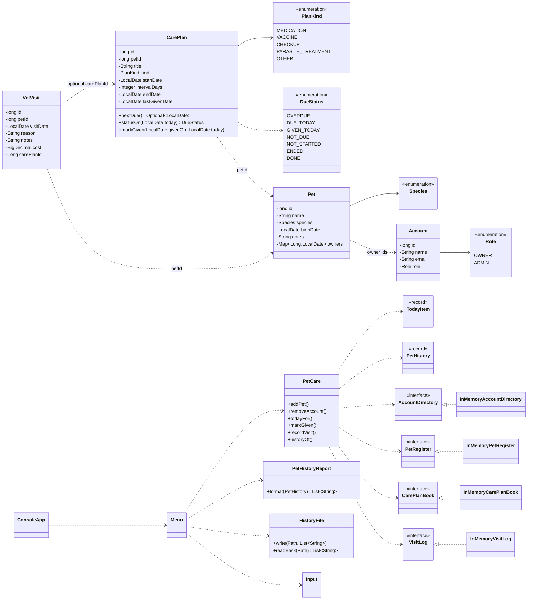

# Class diagram

This is the planned class diagram for the mid-term. Dashed arrows mean "refers to by id": the class holds only the id, not the object. The domain classes depend on neither Spring nor any storage technology. The console (`Menu`) calls `PetCare`, which calls the storage interfaces.

## Mapping to database tables

| Java class | Table(s) |
|---|---|
| `Account` | `ACCOUNT` |
| `Pet` (and its `owners` map) | `PET`, `OWNERSHIP` |
| `CarePlan` | `CARE_PLAN` |
| `VetVisit` | `VET_VISIT` |

`PLACE` has no Java class for now.
