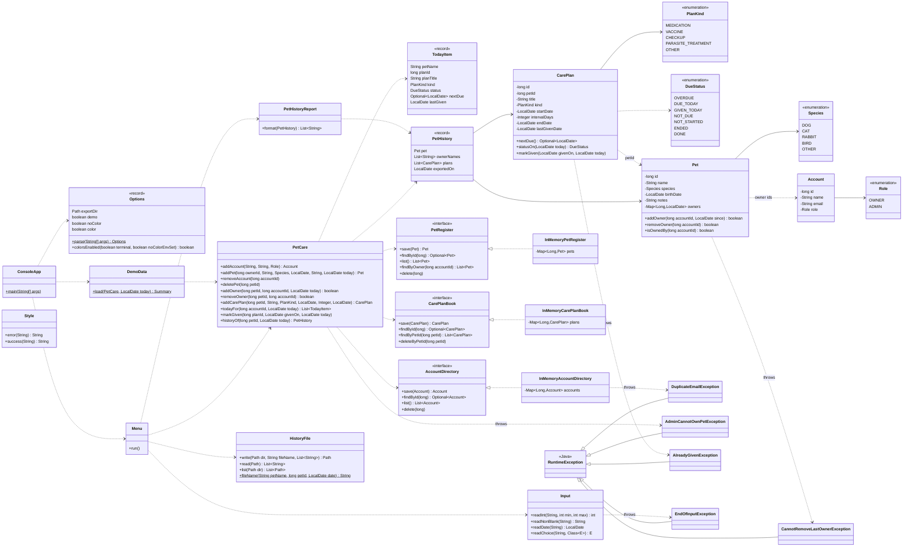

# Class diagram

This is the class diagram of the mid-term code (console, in-memory storage). Dashed arrows mean "uses" or "refers to by id": a class that refers to another by id holds only the id, not the object. The domain classes (`account`, `pet`, `careplan`) depend on neither Spring nor any storage technology. The console (`Menu`) calls `PetCare`, which calls the storage interfaces. For readability the diagram shows the main methods only, and it leaves out the `Style` arrows (used by `Menu` and `Input`) and most exception arrows.

## Notes

- **Vet visits are not built in the mid-term.** They are in the ER diagram and in the business rules, but there is no `VetVisit`, `VisitLog` or visit code yet. `PetHistoryReport` builds the report one section per method, so a vet visits section can be added later.
- **Exceptions** are all unchecked (`RuntimeException`), one per rule, in the root package: `DuplicateEmailException` (same email twice), `AdminCannotOwnPetException` (an ADMIN account cannot own a pet), `CannotRemoveLastOwnerException` (a pet always keeps one owner), `AlreadyGivenException` (a one-off given twice, or a date not after the last one) and `EndOfInputException` (the console input ended).
- **Static methods** are marked with `$`: `HistoryFile.fileName`, `Options.parse`, `DemoData.load` and `ConsoleApp.main`.

## Java course requirements

- **Classes (more than 4), all about the application:** `Account`, `Pet`, `CarePlan`, `PetCare`, `PetHistoryReport`, `HistoryFile`, `Menu`, `Input`, `Options`, `DemoData`, `Style`, `ConsoleApp` and the three `InMemory` stores.
- **Interfaces (2 or more):** `AccountDirectory`, `PetRegister` and `CarePlanBook`. They are named after the domain, not `Repository` or `Manager`, and each has an in-memory implementation that could be replaced by a database one.
- **Collections used by the application:**
  - `Map<Long, LocalDate> owners` in `Pet` (a `HashMap`: owner account id to the date they became an owner).
  - `Map<Long, Account>`, `Map<Long, Pet>` and `Map<Long, CarePlan>` (`HashMap`s) in the three `InMemory` stores.
  - `List`s: the `ArrayList` of items built and sorted in `PetCare.todayFor`, `PetHistory.ownerNames` and `PetHistory.plans`, the lines returned by `PetHistoryReport.format`, and the files returned by `HistoryFile.list`.
- **File feature:** `HistoryFile` writes a pet's history to a text file and reads it back (the Pets menu: "Export history" and "View an exported history").

## Mapping to database tables

| Java class | Table(s) |
|---|---|
| `Account` | `ACCOUNT` |
| `Pet` (and its `owners` map) | `PET`, `OWNERSHIP` |
| `CarePlan` | `CARE_PLAN` |

`PLACE` and `VET_VISIT` have no Java class for now.
